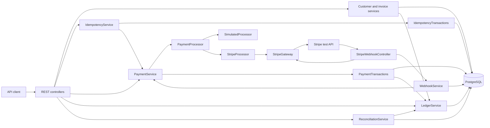
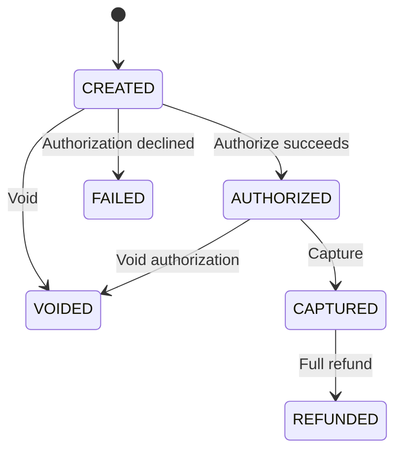
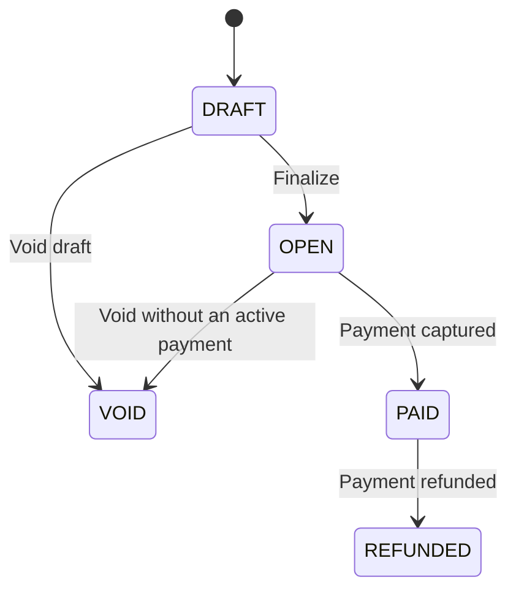

# Ledgerline

[](https://github.com/hardikjain710/Ledgerline/actions/workflows/ci.yml)

Ledgerline is a Java REST backend for billing customers, issuing invoices, and collecting full payments. It records payment history, posts a double-entry ledger in USD or INR, and saves on-demand reconciliation reports. Payments run through a local simulator or Stripe test mode.

## Why this project

Payment systems have to stay consistent when requests are retried, clients race, or a webhook arrives before an API response. This project uses payment and invoice state machines, idempotency, balanced ledger entries, and reconciliation to make those cases observable and testable.

## Features

- Create and list customers and invoices. Invoice line items keep their submitted order and are fixed at creation.
- Finalize or void invoices. Authorize, capture, void, or fully refund payments and read their status history.
- Replay completed payment POSTs by idempotency key.
- Query per-currency ledger balances and postings by invoice or payment ID.
- Verify and deduplicate Stripe test-mode webhooks and apply valid transitions.
- Run reconciliation and retrieve the latest saved report.

## Tech stack

| Component | Version or configuration |
| --- | --- |
| Java | 21 |
| Spring Boot | 3.5.16 with Spring Web, Spring Data JPA, Bean Validation, and Actuator |
| Maven Wrapper | Maven 3.9.11 |
| PostgreSQL | 16 via Docker Compose and Testcontainers |
| Flyway | 11.7.2, managed by Spring Boot |
| Stripe Java SDK | 34.2.0 |
| Testcontainers | 1.21.4, managed by Spring Boot |
| JaCoCo | 0.8.16 |
| Testing and CI | JUnit 5, Mockito, AssertJ, and GitHub Actions |

[Spring Boot 3.5.16 dependency catalog](https://github.com/spring-projects/spring-boot/blob/v3.5.16/spring-boot-project/spring-boot-dependencies/build.gradle)

## Getting started

You need Java 21 and a running Docker engine with Docker Compose. The walkthrough also uses Bash, curl, grep, and cut. Run the following commands from the repository root.

```sh
docker compose up -d
./mvnw spring-boot:run
```

With the local defaults, PostgreSQL listens on port 5432 and the API listens on port 8080. Flyway creates the schema and seeds the four ledger accounts. Hibernate validates the schema at startup.

```sh
curl -fsS http://localhost:8080/actuator/health
```

Expect `{"status":"UP"}` once the app is ready.

| Environment variable | Default or requirement |
| --- | --- |
| `DB_URL` | `jdbc:postgresql://localhost:5432/billing` |
| `DB_USER` | `postgres` |
| `DB_PASSWORD` | `pass` for local development |
| `BILLING_PROCESSOR` | `simulated`. Set to `stripe` for Stripe test mode |
| `STRIPE_API_KEY` | Required at startup in Stripe mode. Only keys beginning with `sk_test_` are accepted |
| `STRIPE_WEBHOOK_SECRET` | Required to verify webhooks. The endpoint returns `500` if the signing secret is missing |

Provide Stripe secrets through environment variables and keep them out of version control.

## Architecture



Controllers handle HTTP and services implement billing rules. The database arrows represent repository calls. `PaymentTransactions` performs short writes after API-driven processor calls. `WebhookService` opens the delivery transaction, and the shared payment write joins it. `IdempotencyTransactions` commits the key reservation separately before payment work begins.

## State machines

### Payment



`FAILED`, `VOIDED`, and `REFUNDED` are terminal. Voiding a `CREATED` payment requires only a local transition. Voiding an `AUTHORIZED` payment through the API also cancels the authorization at the processor.

### Invoice



Finalization requires a positive total. `VOID` and `REFUNDED` are terminal. The service prevents voiding an open invoice with a payment in `CREATED`, `AUTHORIZED`, or `CAPTURED`. Unsupported transitions on the billing API return `409 invalid_state_transition`.

## Ledger and reconciliation

| Kind | Debit | Credit | Amount |
| --- | --- | --- | --- |
| `INVOICE_FINALIZED` | `ACCOUNTS_RECEIVABLE` | `REVENUE` | Invoice total |
| `INVOICE_VOIDED` | `REVENUE` | `ACCOUNTS_RECEIVABLE` | Invoice total |
| `PAYMENT_CAPTURED` | `CASH` | `ACCOUNTS_RECEIVABLE` | Payment amount |
| `PAYMENT_REFUNDED` | `REFUNDS` | `CASH` | Payment amount |

Each posting balances and has a unique `(kind, reference_id)`. Invoice postings use the invoice ID. Payment postings use the payment ID. Voiding a draft invoice, authorizing a payment, and voiding a payment leave the ledger unchanged.

For a **USD 250.00** invoice starting from zero, the balances below are in cents. The asset and refund balances use debits minus credits. Revenue uses credits minus debits.

| Stage | Accounts receivable | Cash | Revenue | Refunds |
| --- | ---: | ---: | ---: | ---: |
| Finalized | 25,000 | 0 | 25,000 | 0 |
| Authorized | 25,000 | 0 | 25,000 | 0 |
| Captured | 0 | 25,000 | 25,000 | 0 |
| Refunded | 0 | 0 | 25,000 | 25,000 |

The balances endpoint always returns eight rows, with one row for each account and supported currency. Reconciliation reads one database snapshot. It checks debit and credit totals for each transaction and currency, checks required postings against the source payment or invoice, and compares accounts receivable with open invoice totals in each currency. It saves `OK` with an empty `details` array or `MISMATCH` with the issues found. A total outside the Java `long` range returns `500 internal_error`.

## How idempotency works

1. The five payment POSTs require an `Idempotency-Key` of 8–255 characters. The request is validated before a reservation is created.
2. The scope is the HTTP method plus the request path. The service hashes the raw request bytes with SHA-256. Bodyless actions hash an empty byte sequence.
3. A new key reserves an `IN_PROGRESS` row in its own committed `REQUIRES_NEW` transaction. The database uniqueness constraint settles a race between simultaneous inserts.
4. A different body in the same scope returns `422 idempotency_key_reuse`. A matching request still in progress returns `409 idempotency_in_progress`.
5. A completed request replays the stored status and exact JSON body with `Idempotent-Replayed: true`. This includes business errors such as an invalid transition. A `5xx` response deletes the reservation so the same key can be tried again.

## How Stripe webhooks work

The handler verifies the `Stripe-Signature` against the raw body with Stripe’s SDK before application parsing or writes. With a configured signing secret, an invalid or missing signature returns `400` with no stored event.

A verified event is inserted in `webhook_events` or matched by event ID. A database row lock serializes deliveries of the same event. If `processed_at` is set, the handler returns `200` immediately.

| Stripe event | Target payment state |
| --- | --- |
| `payment_intent.amount_capturable_updated` | `AUTHORIZED` |
| `payment_intent.succeeded` | `CAPTURED` |
| `payment_intent.payment_failed` | `FAILED` |
| `payment_intent.canceled` | `VOIDED` |
| `charge.refunded` | `REFUNDED` |

The handler looks up the payment by metadata `paymentId` first, then by PaymentIntent reference. It fills a missing processor reference when the event supplies one. A valid transition reuses the API’s status, history, invoice, and ledger writes without calling the processor. The history actor is `WEBHOOK` and the reason is the event type. The transition and `processed_at` commit together.

An already-applied or invalid transition, an existing posting for the target transition, or an unhandled event is marked processed and returns `200`. An unmatched payment leaves the row unprocessed and returns `404` so Stripe can retry. An unexpected error returns `500` and rolls back that delivery’s changes.

## API reference

Money values in JSON are integer minor units. Customer and invoice lists support `page` (default `0`) and `size` (default `20`, maximum `100`), ordered by newest creation time and then descending ID.

| Method | Path | Purpose | Idempotency-Key |
| --- | --- | --- | --- |
| POST | `/api/v1/customers` | Create a customer with `name` and `email` | No |
| GET | `/api/v1/customers/{id}` | Get a customer | No |
| GET | `/api/v1/customers` | List customers | No |
| POST | `/api/v1/invoices` | Create a draft with `customerId`, `currency`, and `lineItems` | No |
| GET | `/api/v1/invoices/{id}` | Get an invoice and its line items | No |
| GET | `/api/v1/invoices` | List invoices with optional `customerId` and `status` filters | No |
| POST | `/api/v1/invoices/{id}/finalize` | Finalize a draft invoice | No |
| POST | `/api/v1/invoices/{id}/void` | Void an eligible invoice | No |
| POST | `/api/v1/invoices/{id}/payments` | Create a full-amount payment with `paymentMethodToken` | Yes |
| GET | `/api/v1/payments/{id}` | Get a payment | No |
| GET | `/api/v1/payments/{id}/history` | List status history by ascending history ID | No |
| POST | `/api/v1/payments/{id}/authorize` | Authorize a created payment | Yes |
| POST | `/api/v1/payments/{id}/capture` | Capture the authorized amount | Yes |
| POST | `/api/v1/payments/{id}/void` | Void a created or authorized payment | Yes |
| POST | `/api/v1/payments/{id}/refund` | Refund a captured payment in full | Yes |
| GET | `/api/v1/ledger/balances` | Return balances by account and currency | No |
| GET | `/api/v1/ledger/transactions?referenceId={uuid}` | List postings and their entries for a required invoice or payment ID | No |
| POST | `/api/v1/admin/reconciliation/run` | Run reconciliation and store a report | No |
| GET | `/api/v1/admin/reconciliation/latest` | Get the most recent report | No |
| POST | `/webhooks/stripe` | Receive a test-mode event with `Stripe-Signature` | No |
| GET | `/actuator/health` | Check application health | No |

Application errors have a top-level `error` object with `code`, `message`, and optional `details`.

| HTTP | Error code | When |
| ---: | --- | --- |
| 400 | `validation_error` | Invalid input, key length, or Stripe signature |
| 400 | `idempotency_key_required` | A protected request has a missing or blank key |
| 404 | `not_found` | An ID is unknown, a handled event has no matching payment, or no reconciliation report exists |
| 409 | `invalid_state_transition` | The current state or an invoice void guard disallows the action |
| 409 | `payment_already_active` | The invoice already has an active payment |
| 409 | `concurrent_modification` | An optimistic lock detects a stale write |
| 409 | `idempotency_in_progress` | A matching request already holds the reservation |
| 409 | `duplicate_email` | The normalized customer email already exists |
| 422 | `idempotency_key_reuse` | The same key and scope have a different body hash |
| 502 | `processor_error` | Capture, void, or refund has a non-transient processor failure |
| 503 | `processor_unavailable` | Transient processor failure or a Stripe status the operation cannot complete yet |
| 500 | `internal_error` | Unexpected failure, ledger overflow, or missing webhook signing secret |

## Simulated payment walkthrough

Start with `BILLING_PROCESSOR=simulated` or the default setting. On a fresh database the balance changes match the worked example above. The commands print each response and stop on an unexpected HTTP status.

```bash
bash <<'BASH'
set -euo pipefail
api=http://localhost:8080/api/v1
run="$(date +%s)-$$"

request() {
  local expected=$1 result actual
  shift
  result=$(curl -sS -w $'\n%{http_code}' "$@")
  actual=${result##*$'\n'}
  body=${result%$'\n'*}
  printf '%s\nHTTP %s\n' "$body" "$actual"
  [[ "$actual" == "$expected" ]]
}

json_id() {
  local ids
  ids=$(grep -oE '"id"[[:space:]]*:[[:space:]]*"[[:xdigit:]-]{36}"' <<<"$body" | cut -d '"' -f4)
  printf '%s\n' "${ids%%$'\n'*}"
}

request 201 -H 'Content-Type: application/json' \
  -d "{\"name\":\"Demo Customer\",\"email\":\"demo-$run@example.com\"}" \
  "$api/customers"
customer_id=$(json_id)

request 201 -H 'Content-Type: application/json' \
  -d "{\"customerId\":\"$customer_id\",\"currency\":\"USD\",\"lineItems\":[{\"description\":\"Consulting\",\"quantity\":1,\"unitAmount\":25000}]}" \
  "$api/invoices"
invoice_id=$(json_id)

request 200 -X POST "$api/invoices/$invoice_id/finalize"
request 201 -H 'Content-Type: application/json' -H "Idempotency-Key: $run-create" \
  -d '{"paymentMethodToken":"tok_success"}' "$api/invoices/$invoice_id/payments"
payment_id=$(json_id)

request 200 -X POST -H "Idempotency-Key: $run-authorize" "$api/payments/$payment_id/authorize"
request 200 -X POST -H "Idempotency-Key: $run-capture" "$api/payments/$payment_id/capture"
request 200 "$api/ledger/balances"
request 200 -X POST -H "Idempotency-Key: $run-refund" "$api/payments/$payment_id/refund"
request 200 "$api/ledger/balances"
request 200 -X POST "$api/admin/reconciliation/run"
BASH
```

The payment moves through `CREATED`, `AUTHORIZED`, `CAPTURED`, and `REFUNDED`. The reconciliation response is `OK` with `details: []` on a healthy database. For simulator error paths, use `tok_decline` to get a `FAILED` payment or `tok_error` to get `503 processor_unavailable` during authorization.

## Running with Stripe test mode

In a terminal with the Stripe CLI installed, sign in to your test account or sandbox and start forwarding snapshot events.

```sh
stripe login
stripe listen --forward-to localhost:8080/webhooks/stripe
```

Keep the listener running. Copy the `whsec_` signing secret it prints. In a second terminal, start PostgreSQL and enter both secrets at hidden prompts. Paste each value only at its prompt. Keep the values out of files and shell history.

```sh
docker compose up -d
(
  set +x
  printf 'Stripe test API key: '
  IFS= read -r -s STRIPE_API_KEY
  printf '\nStripe listener signing secret: '
  IFS= read -r -s STRIPE_WEBHOOK_SECRET
  printf '\n'
  export STRIPE_API_KEY STRIPE_WEBHOOK_SECRET
  BILLING_PROCESSOR=stripe ./mvnw spring-boot:run
)
```

Run the walkthrough with a new USD invoice and replace `tok_success` with `pm_card_visa`. To exercise decline, use `pm_card_chargeDeclined` on a separate invoice and stop after authorization returns a `FAILED` payment. If a matching webhook commits first and the API returns `409 concurrent_modification`, fetch the payment to confirm its state before proceeding. Test account capabilities can affect which currencies and cards are accepted. [Stripe local webhook testing](https://docs.stripe.com/webhooks#test-webhook) · [Stripe test payment methods](https://docs.stripe.com/testing)

## Tests and CI

Start Docker and run the verification build.

```sh
./mvnw -B verify
```

The suite defines **166 test cases**, including parameterized cases and repeated races. The PostgreSQL integration tests use Testcontainers and the real Flyway migrations. Stripe tests use a mocked gateway or locally signed webhook fixtures.

The JaCoCo report is at `target/site/jacoco/index.html`. The Maven gate requires **80% combined line coverage** across classes in the `service` and `statemachine` packages. Measured combined line coverage is **99%**. The `CI` workflow runs the same Maven command on pushes and pull requests and uploads the report when coverage data is available.

## Design decisions and trade-offs

- **Integer minor units.** Using `long` avoids floating-point rounding in totals and postings. Checked arithmetic turns overflow into an error.
- **Three database concurrency safeguards.** Optimistic versions detect stale payment and invoice updates. The partial unique index enforces one active payment per invoice, and a pessimistic invoice lock serializes payment creation against invoice void.
- **Unique ledger postings.** PostgreSQL enforces one posting per `(kind, reference_id)`. Ledger writes join the state-change transaction so status, history, and financial records roll back together on failure.
- **Processor calls outside database transactions.** This keeps database locks away from network waits. A successful processor call followed by a failed local write leaves a gap that requires investigation using the logged payment ID and processor reference.
- **Raw-body hashing.** A hash over the received bytes makes duplicate detection independent of JSON deserialization. Whitespace changes produce a different hash, so a retry must send the same bytes.
- **Shared API and webhook transition code.** Both paths use the same state machine and write logic, so either path produces the same invoice and ledger effects. Webhook history retains its own actor and event type.
- **Per-currency reconciliation.** INR and USD are checked separately so a discrepancy in one currency cannot cancel a discrepancy in another. Each transaction is also checked independently to catch offsetting errors within a currency.

## Known limitations and future work

- Different processor actions, such as capture and void, can race before the database write. There are no pending payment states. Stripe results that require waiting return `503`.
- There is no outbox or automated recovery for an external success followed by a failed local write. A durable operation record, pending states, and an outbox-backed worker could make dispatch and recovery observable and retryable.
- A stranded `IN_PROGRESS` reservation requires manual recovery. Check the current payment state before retrying with a new key. There is no key cleanup job.
- Each invoice supports one full payment at a time. Failed or voided attempts remain in history and an open invoice can be retried. Split payments and partial refunds are outside scope.
- The webhook maps `charge.refunded` to a full local refund. A partial refund initiated directly in Stripe can emit the same event, so the test flow assumes refunds are initiated through the full-refund API. [Stripe event types](https://docs.stripe.com/api/events/types#event_types-charge.refunded)
- Billing and reconciliation endpoints have no authentication. There is no UI, currency conversion, or scheduled reconciliation.
